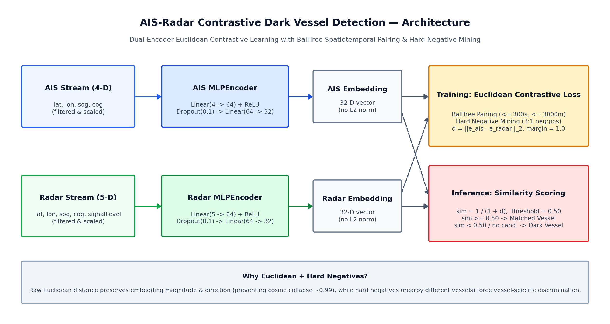
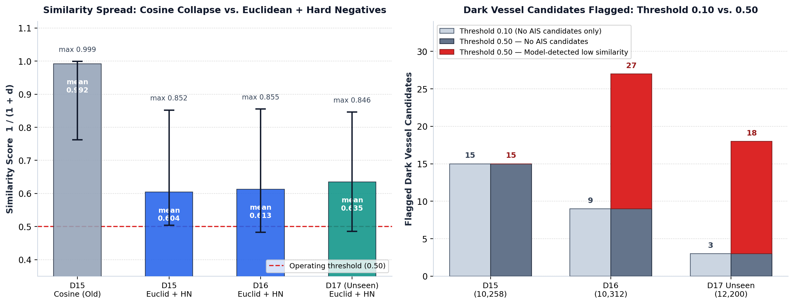
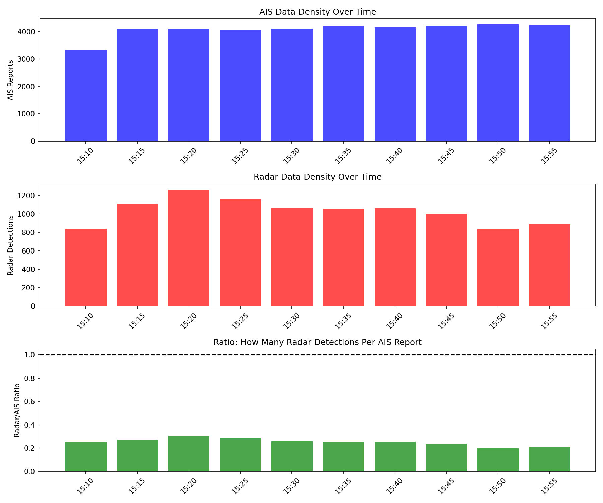

# AIS-Radar Contrastive Multimodal Learning

This project implements a contrastive learning approach to match AIS (Automatic Identification System) vessel data with radar detections, and identify potential **dark vessels** — ships operating without AIS transmissions.

> **Data Notice:** Raw AIS/Radar datasets, sample rows, vessel-level outputs (`outputs_*/*.csv`), and coordinate maps are private Coast Guard property and are intentionally excluded from this repository.

---

## Architecture



---

## Project Structure

```
AIS-Radar-Dark-Vessel-Detection/
├── src/
│   ├── train.py              # Train the contrastive model (multi-dataset)
│   ├── match_targets.py      # Match radar targets & detect dark vessels
│   ├── create_pairs.py       # Generate positive/negative training pairs
│   ├── dataset.py            # PyTorch Dataset for contrastive learning
│   ├── model.py              # Contrastive neural network architecture
│   ├── preprocess.py         # Data cleaning and preprocessing utilities
│   ├── compare_multi.py      # Compare results across configurations
│   └── debug_pairs.py        # Inspect generated training pairs
├── figures/
│   ├── architecture.png      # Dual-encoder Euclidean contrastive architecture
│   └── results_comparison.png# Similarity spread & threshold comparison plots
├── data/                     # Local dataset directory (gitignored; place private AIS/Radar CSVs here)
├── outputs_euclidean/        # Trained model weights (ais_radar_contrastive.pth) & scaler.pkl
├── analyze_dark.py           # Dark vessel analysis script
├── compare_datasets.py       # Cross-dataset comparison utility
├── diagnose_csv.py           # CSV schema diagnostic script
├── investigate_timing.py     # Temporal alignment analysis
├── plot_map.py               # Spatial visualization script
├── priority_report.py        # Candidate prioritization report
├── data_density_analysis.png # Aggregate dataset density chart
├── Dark_Vessel_Model_Development.pptx
├── Results_Threshold_0.10_vs_0.50.txt
├── CHANGELOG.md
└── requirements.txt
```

---

## 1. Install Requirements

```bash
pip install -r requirements.txt
```

**requirements.txt:**
```
pandas
numpy
torch
scikit-learn
tqdm
```

---

## 2. Train the Model (Multi-Dataset with Hard Negative Mining)

Train on multiple AIS/Radar datasets combined, then test on held-out data.

```bash
python src/train.py \
  --ais_csv "data/AIS-15.csv" "data/AIS-16.csv" \
  --radar_csv "data/Radar-15.csv" "data/Radar-16.csv" \
  --out_dir outputs_multi \
  --epochs 20 \
  --batch_size 256 \
  --lr 0.001 \
  --max_time_sec 300 \
  --max_dist_m 3000 \
  --val_ratio 0.2
```

**What it does:**
- Parses multiple AIS and radar CSV files
- Extracts features (latitude, longitude, SOG, COG, signal level)
- Handles Excel formula-wrapped datetimes
- Extracts SOG/COG from JSON `data` column in AIS
- Filters invalid positions (lat=0, lon=0)
- Builds **BallTree spatial index** for fast O(n log m) pairing
- Generates positive pairs based on spatiotemporal proximity
- Generates **hard negative pairs** — vessels close in time/space but different identities
- Trains a contrastive neural network with **Euclidean-based contrastive loss**
- Saves model, scaler, and training pairs

---

## 3. Match Radar Targets & Detect Dark Vessels

Test the trained model on a single held-out dataset:

```bash
python src/match_targets.py \
  --ais_csv "data/AIS-16.csv" \
  --radar_csv "data/Radar-16.csv" \
  --model_path outputs_multi/ais_radar_contrastive.pth \
  --scaler_path outputs_multi/scaler.pkl \
  --out_dir outputs_16_multi \
  --similarity_threshold 0.50 \
  --max_time_sec 300 \
  --max_dist_m 3000
```

**What it does:**
- Loads trained model and scaler
- For each radar target, finds AIS candidates within time and distance windows
- Computes **Euclidean distance** between embeddings
- Converts to similarity score: `sim = 1 / (1 + dist)`
- Flags radar targets with similarity < threshold as **dark vessel candidates**

---

## 4. Compare Results Across Configurations

```bash
python src/compare_multi.py
```

---

## Results





### Threshold 0.10 vs 0.50 (Euclidean + Hard Negative Mining)

| Dataset | Threshold | Total Radar | Matched | Dark Vessels | Dark % | Model-Detected | No Candidates |
|---------|-----------|-------------|---------|--------------|--------|----------------|---------------|
| **15** | 0.10 | 10,258 | 10,243 | 15 | 0.15% | 0 | 15 |
| **15** | **0.50** | 10,258 | 10,243 | 15 | 0.15% | 0 | 15 |
| **16** | 0.10 | 10,312 | 10,303 | 9 | 0.09% | 0 | 9 |
| **16** | **0.50** | 10,312 | 10,285 | **27** | **0.26%** | **18** | 9 |
| **17** | 0.10 | 12,200 | 12,197 | 3 | 0.02% | 0 | 3 |
| **17** | **0.50** | 12,200 | 12,182 | **18** | **0.15%** | **15** | 3 |

> At threshold 0.10, the model matches 100% of targets with AIS candidates. At threshold 0.50, the model actively rejects 15-18 poor matches per dataset based on low embedding similarity.

---

### Similarity Distribution (Threshold 0.50)

| Metric | Dataset 15 | Dataset 16 | Dataset 17 |
|--------|-----------|-----------|-----------|
| **Mean** | 0.604 | 0.613 | 0.635 |
| **Std** | 0.068 | 0.057 | 0.065 |
| **Min** | 0.504 | 0.483 | 0.485 |
| **10th %ile** | 0.532 | 0.545 | 0.555 |
| **25th %ile** | 0.555 | 0.573 | 0.586 |
| **50th %ile** | 0.580 | 0.613 | 0.625 |
| **75th %ile** | 0.646 | 0.640 | 0.675 |
| **90th %ile** | 0.700 | 0.702 | 0.720 |
| **95th %ile** | 0.748 | 0.721 | 0.755 |
| **99th %ile** | 0.815 | 0.806 | 0.812 |
| **Max** | 0.852 | 0.855 | 0.846 |

---

## Why Euclidean Loss + Hard Negative Mining?

### The Problem with Cosine Similarity

We initially used cosine similarity with L2-normalized embeddings, following common contrastive learning practice. However, this led to **representation collapse** — all similarities clustered near 0.99, and the model lost discriminative power.

| Metric | Cosine (Collapsed) | Euclidean + Hard Negs |
|--------|-------------------|----------------------|
| Mean similarity | 0.993 | 0.613 |
| Std | 0.018 | 0.057 |
| Min | 0.762 | 0.483 |
| Max | 0.999 | 0.855 |
| Model-detected dark vessels | 0 | 15-18 |

### Why Euclidean Loss Prevents Collapse

| Aspect | Cosine | Euclidean |
|--------|--------|-----------|
| What it measures | Angle only | Magnitude + direction |
| Collapse risk | High | Lower |
| Training stability | Collapsed to ~0.03 loss | Stable at ~0.17 loss |

With Euclidean distance, the model cannot simply align all vectors in the same direction — it must actually separate negatives in the embedding space. The margin (1.0) creates a buffer zone that forces meaningful separation.

### Why Hard Negative Mining Matters

**Random negatives (before):**
```
Radar at Location A, 15:00
  └── Negative: AIS at Location Z, 20:00 (100 km away)
  Model learns: 'Far apart = different' ← Trivially easy
```

**Hard negatives (after):**
```
Radar at Location A, 15:00
  ├── Positive: AIS Vessel 1 at 50m away ← Same vessel
  └── Negative: AIS Vessel 2 at 180m away ← Different vessel!
  Model must learn: 'Same area, same time, but different = different'
```

Hard negatives force the model to learn **vessel-specific features** (speed, course, signal characteristics) rather than just 'same location = same vessel.'

---

## Key Technical Improvements

### 1. BallTree Spatial Indexing
Reduces pairing complexity from **O(n x m)** to **O(n log m)**, cutting pairing time from ~20-40 minutes to **under 1 minute**.

### 2. Multi-Dataset Training
Train on multiple datasets simultaneously (15+16), improving generalization to unseen data (17). Each dataset is tagged with `dataset_id` for tracking.

### 3. Controlled Pair Generation
Fixed 3,000 positive + 9,000 negative pairs per dataset, ensuring reproducible, balanced training.

### 4. Hard Negative Mining
Negatives are drawn from vessels **close in time and space but different identities**, forcing the model to learn fine-grained vessel-specific features.

### 5. Euclidean-Based Contrastive Loss
Uses raw Euclidean distance with a margin-based loss, preventing representation collapse common with cosine-only approaches.

---

## Source Code

See individual source files in `src/` directory.

---

## Author

Project implementing contrastive multimodal learning for AIS-Radar vessel matching with BallTree spatial indexing, multi-dataset training, and hard negative mining.
